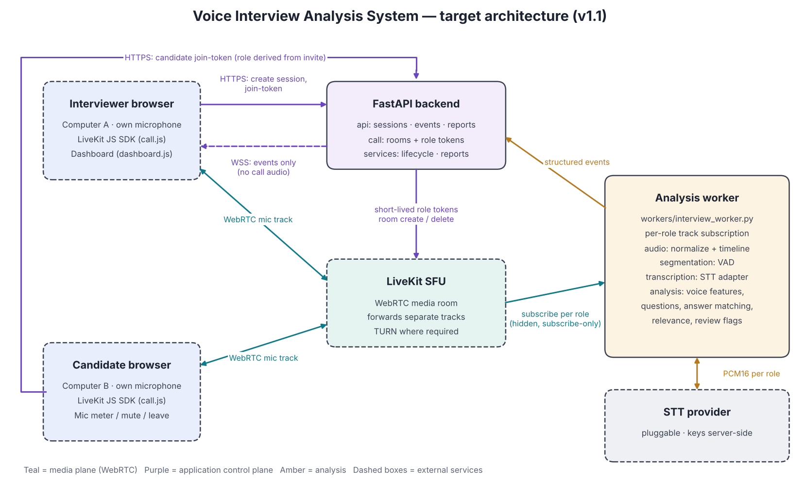

# Voice Interview Analyzer

Live English interview assistance for an **in-app audio call between two networked computers**.
The interviewer and candidate each join from their own browser with their own microphone; a
server-side worker analyses each participant's audio track separately and streams structured,
timestamped events (transcript, voice metrics, questions, answer relevance, review flags) to the
interviewer dashboard.

> **Responsible use.** Every flag is a *review cue for a human*, with evidence and uncertainty.
> The system makes no pass/fail, ranking, honesty, or "AI-authored" judgements
> (see `docs/project_documentation.pdf`, Sections 11–12 and Appendix C).



## What's in this repository

| Area | Status | Where |
|---|---|---|
| M0 local microphone test (two-input level meter) | ✅ Working | `static/index.html`, `GET /` |
| Sessions, role-specific invites, join tokens, finish/delete | ✅ Working | `app/api/sessions.py`, `app/services/session_service.py` |
| LiveKit room + short-lived role tokens (mic-only publish) | ✅ Implemented — needs LiveKit credentials | `app/call/` |
| In-app call UI (join, mute, leave, reconnect states) | ✅ Implemented — needs LiveKit | `frontend/` |
| Analysis worker: per-role track subscription | ✅ Implemented — needs LiveKit | `app/workers/interview_worker.py` |
| Audio adapters + session timeline | ✅ Working, tested | `app/audio/` |
| VAD / segmentation (adaptive energy) | ✅ Working, tested | `app/segmentation/vad.py` |
| Voice features (RMS, F0, rate, within-candidate baseline) | ✅ Working, tested | `app/analysis/voice_features.py` |
| Question detection, answer pairing, relevance, review flags | ✅ Baselines, tested | `app/analysis/` |
| Live dashboard over WSS + final JSON report | ✅ Working | `app/api/events.py`, `app/api/reports.py` |
| Speech-to-text | 🟡 Pluggable adapter; provider not yet wired | `app/transcription/service.py` |

The analysis modules are deliberately simple, transparent baselines (rule-based question detection,
lexical relevance, autocorrelation pitch). Each sits behind a small interface so it can be swapped for
a model-based implementation after evaluation (Section 10 of the documentation).

## Project structure

```
voice-interview-analyzer/
├── main.py                 FastAPI entry point (/, /health, /app/, /api/...)
├── requirements.txt
├── .env.example            Placeholder configuration — copy to .env
├── static/index.html       M0 microphone-test prototype
├── frontend/               In-app call UI + interviewer dashboard
│   ├── index.html
│   ├── css/styles.css
│   └── js/{app,call,audio,dashboard}.js
├── app/
│   ├── config.py           Environment settings
│   ├── api/                sessions.py · events.py (WebSocket) · reports.py
│   ├── call/               rooms.py · tokens.py (LiveKit)
│   ├── audio/              normalization.py · timestamps.py
│   ├── workers/            interview_worker.py (pipeline + LiveKit subscriber)
│   ├── transcription/      service.py (provider adapters)
│   ├── segmentation/       vad.py
│   ├── analysis/           voice_features · question_detection · answer_matching · relevance · review_flags
│   ├── schemas/events.py   Pydantic request/response + event contracts
│   └── services/           session_service.py · report_service.py
├── tests/                  pytest suite (50 tests)
└── docs/                   architecture.png · project_documentation.pdf
```

## Setup (Windows PowerShell)

```powershell
cd voice-interview-analyzer
python -m venv .venv
.\.venv\Scripts\Activate.ps1
python -m pip install -r requirements.txt
copy .env.example .env      # then edit values
uvicorn main:app --reload
```

macOS / Linux: `python3 -m venv .venv && source .venv/bin/activate`, then the same commands (`cp` instead of `copy`).

Open:

* <http://127.0.0.1:8000/> — M0 microphone test
* <http://127.0.0.1:8000/app/> — call UI and dashboard
* <http://127.0.0.1:8000/docs> — interactive API docs

Run the tests with `pytest`.

## Try it without LiveKit (dev mode)

With `DEV_MODE=true` and no LiveKit credentials:

1. Open `/app/`, click **Create interview session**.
2. Click **Open dashboard without call (dev)**.
3. Use the dev transcript box to type interviewer and candidate lines. You will see questions detected,
   answers paired, relevance labels and flags appear live. **End interview** finalises the report.

## Running a real two-computer call

1. Create a LiveKit project (LiveKit Cloud recommended to start) and set `LIVEKIT_URL`,
   `LIVEKIT_API_KEY`, `LIVEKIT_API_SECRET` in `.env`.
2. Serve the app over **HTTPS** at an address both computers can reach — browsers only allow
   microphone access on HTTPS or `localhost`. For testing, a tunnel (e.g. `cloudflared`, `ngrok`) or a
   reverse proxy with a certificate works.
3. Interviewer opens `/app/`, creates a session, and sends the **candidate link** to the candidate.
4. Both join from their own computers. The analysis worker joins automatically as a hidden,
   subscribe-only participant when the first join token is issued.
5. Configure a transcription provider (`TRANSCRIPTION_PROVIDER`) to get live transcripts; until then
   the worker still produces VAD segments and candidate voice metrics.

## API summary

| Method & path | Auth | Purpose |
|---|---|---|
| `GET /health` | — | Health + non-secret feature flags |
| `POST /api/sessions` | — | Create session → `session_id`, role invite codes |
| `GET /api/sessions/{id}` | `X-Invite-Code` | Session status |
| `POST /api/sessions/{id}/join-token` | invite in body | Role-specific LiveKit token (role comes from invite) |
| `WS /api/sessions/{id}/events?invite=` | interviewer | Structured dashboard events |
| `POST /api/sessions/{id}/finish` | interviewer | End call, stop worker, finalise analysis |
| `GET /api/sessions/{id}/report` | interviewer | Review report (no pass/fail) |
| `DELETE /api/sessions/{id}` | interviewer | Delete all session data together |
| `POST /api/sessions/{id}/dev/transcript` | interviewer, `DEV_MODE` | Inject a transcript line |

Event types: `session_status`, `transcript.partial`, `segment.completed`, `voice_metrics`,
`question.detected`, `answer.analysis`, `review.flag`, `error` — schemas in `app/schemas/events.py`.

## Security notes

* Invite codes are a **prototype stand-in for real authentication**; replace with SSO/OAuth and
  per-user authorization before production. Roles are always derived server-side.
* LiveKit and transcription secrets never leave the server. Join tokens are short-lived
  (`JOIN_TOKEN_TTL_SECONDS`) and only allow publishing the microphone.
* Sessions are held in memory; nothing is written to disk and no audio is retained
  (`AUDIO_RETENTION_HOURS=0`). Add persistence only under an approved retention policy.
* Set `DEV_MODE=false` outside development.

## Next steps (roadmap from the documentation)

* **M1/M2** — run a LiveKit spike on representative networks (incl. TURN), verify per-track role mapping and timing.
* **M3** — implement a streaming STT adapter in `app/transcription/service.py`; measure WER and latency.
* **M4** — validate voice metrics under controlled gain / distance / noise changes; consider librosa pYIN.
* **M5** — replace lexical relevance with embeddings + a structured rubric; label an evaluation set.
* **M6** — authentication, persistence with retention/deletion, monitoring, fairness review.
